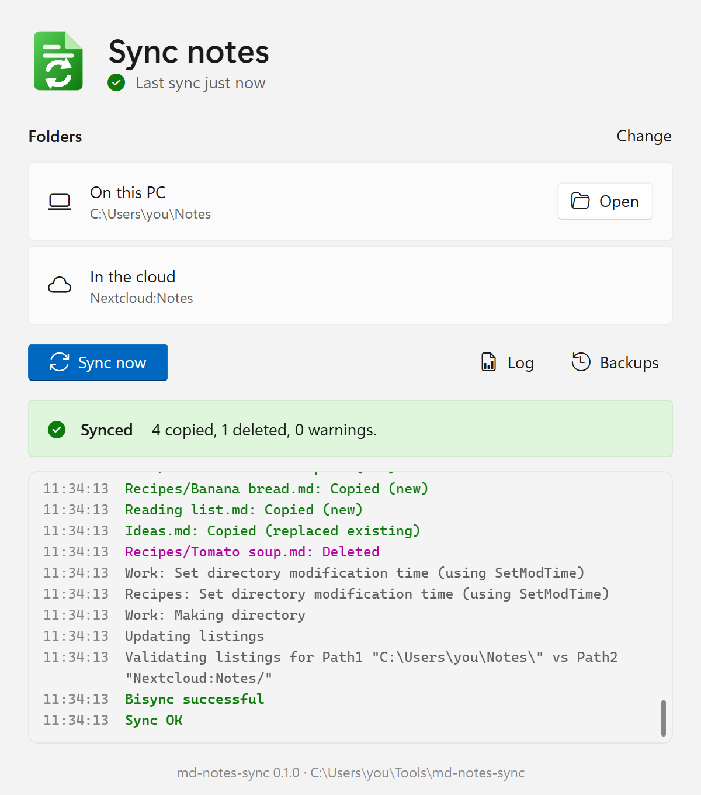

# md-notes-sync

**A small Windows tray app that keeps your Markdown notes in sync between the cloud and a folder on your PC.**

I wrote md-notes-sync to sync my notes between [Nextcloud Notes](https://play.google.com/store/apps/details?id=it.niedermann.owncloud.notes) on Android and my Windows machine, where I use them mainly in [VS Code](https://code.visualstudio.com) with the [Notes extension](https://marketplace.visualstudio.com/items?itemName=dionmunk.vscode-notes) and in [Obsidian](https://obsidian.md). 

New note-taking apps seem to appear every week. I didn't want another one: I'm happy with the apps I already use. What I was missing was a simple, reliable way to keep my notes in sync between them. And because notes are such a basic part of everyday work, I think that tool should be free, open source and, as far as possible, not tied to any one app or cloud solution.

The syncing itself is done by [rclone](https://rclone.org). md-notes-sync runs it with settings that let Nextcloud Notes, Obsidian and VS Code (and other apps, see [SETUP.md](SETUP.md)) share the same notes: note dates stay as they are, categories stay folders (in Nextcloud Notes), and each editor's own config files and folders don't get in the way.

That's my use case. Your Markdown notes can also be in Dropbox, in Google Drive or on an SFTP server, and you can use any notes app or Markdown editor you like on your Windows machine, or just use md-notes-sync to keep a copy of your notes in the cloud or on your disk as a backup.

## What it does

- **You decide when it syncs:** click the tray icon. Nothing runs in the background on its own.
- **You can see what happens:** every copied or deleted file, a progress bar and a summary. A test run shows what a sync would do without changing anything.
- **Notes stay plain files.** Titles, categories (folders), modified dates and images are kept.
- **Safety nets:** a weekly backup, a check that refuses to sync an empty or wrong folder, a limit on deletions, and conflict copies.
- **Portable:** one folder, no installer, no admin rights.

## Install

1. Download `md-notes-sync-<version>.zip` from the [releases](https://github.com/klggr81/md-notes-sync/releases).
2. Unpack it to a folder in your user folder, for example `C:\Users\you\Tools\md-notes-sync`. The app keeps its settings and the connection to your cloud in this folder. Folders there are private to your Windows account; a folder directly on `C:\` (like `C:\Tools`) can be read by every account on the PC.
3. Start `md-notes-sync.exe`. Windows may warn that the app is from an unknown publisher (it isn't signed): click **More info**, then **Run anyway**.

It needs Windows 10 or 11. Windows 11 looks best (the window uses its Mica background).

The first start opens the setup. **[SETUP.md](SETUP.md)** explains each step, daily use, the editors and clouds that work with it, the files in the app folder, and what to do when something goes wrong.

## Safety

- **Weekly backup:** before a sync, if the newest backup is a week old (or there is none), the notes folder is zipped into `backups\notes-YYYY-MM-DD.zip` in the app folder. The newest 3 are kept (`BACKUP_KEEP` in `sync.conf`; 0 turns it off). **Back up now** in the tray menu makes one at once, for example before a big change. For changes since then, the cloud keeps its own history: Nextcloud has versions and a trash bin, Dropbox and Google Drive keep deleted files for 30 days. An SFTP server usually keeps none (a Hetzner Storage Box can take snapshots: turn them on).
- **Access check:** a small file named `RCLONE_TEST` is in the notes folder on both sides. If it's missing on either side (wrong folder, empty folder, disconnected drive), the sync refuses to run instead of deleting everything on the other side. Don't delete it.
- **Deletion limit:** a sync that would delete more than 25 % of the files stops.
- **Conflicts:** if a note was changed on both sides, the newer version wins and the older one is kept as a copy with `.conflict` in its name.
- **Restore:** click **Backups** in the window, open a zip and drag the note out. For one note in Nextcloud, you can also use Files > the note > Versions.

## Security

- **Connections** are always encrypted: HTTPS, checked against the certificates Windows trusts, or for SFTP, SSH, checked against the server key saved at the setup.
- **What is stored:** for Nextcloud, an app password made just for md-notes-sync; for Dropbox and Google Drive, an access token; never your account's password. You can withdraw these any time: Nextcloud > Settings > Security; Dropbox > Settings > Connected apps; Google Account > Security > Third-party connections. For SFTP, the password you entered is stored, so use one only for this, like a Storage Box sub-account.
- **Use a separate account for the sync where you can.** The sign-in gives md-notes-sync access to everything in that account, not only the notes. An account that only sees the notes folder keeps your other files out of reach:
  - **Nextcloud:** create a second user (for example `notes-sync`; on a hosted Nextcloud, if your plan allows more users). Share your Notes folder with it and allow editing. Sign in to md-notes-sync with that user and pick the shared folder in step 4 of the setup. You keep using your own account in the Notes app.
  - **SFTP (Hetzner Storage Box):** a sub-account that only sees the notes folder.
  - **Dropbox, Google Drive:** a second account that your notes folder is shared with. In Google Drive, add the shared folder to its My Drive with **Add shortcut to Drive**.
- **The connection is not encrypted on disk.** `rclone.conf` in the app folder holds the app password in rclone's obscured form, which anyone can turn back into the password, and the access token as plain text. Anyone with a copy of the app folder can reach everything the sign-in reaches: with your own Nextcloud, Dropbox or Google account, that's all your files there, not only the notes. So keep the folder in your user folder and out of shared or uploaded backups. If a copy got out, withdraw the access (see above) and sign in again in the setup.
- **The notes are plain files,** on the PC and in the cloud: that's what lets the Notes app and your editors read them. They're encrypted on the way (HTTPS or SSH). Whether they're encrypted on the server depends on the cloud (for Nextcloud, on the server's settings).
- **The backups** in `backups\` are plain zip files, and `sync.log` lists the file names, which are the note titles.
- **rclone** is downloaded from rclone.org over HTTPS and checked against its checksum.
- **No usage data** is sent. The app only connects to rclone.org (to download rclone), to your cloud, and to GitHub when you check for updates.

## Building

See [DEVELOPMENT.md](DEVELOPMENT.md).

## Credits

- [rclone](https://rclone.org) and its `bisync` command do all the syncing.
- [Nextcloud Notes](https://github.com/nextcloud/notes) and its [Android app](https://github.com/nextcloud/notes-android).
- Built with [Tauri](https://tauri.app).

## License

md-notes-sync is free software: you can redistribute it and/or modify it under the terms of the [GNU General Public License](LICENSE) as published by the Free Software Foundation, either version 3 of the License, or (at your option) any later version.

It is distributed in the hope that it will be useful, but WITHOUT ANY WARRANTY; without even the implied warranty of MERCHANTABILITY or FITNESS FOR A PARTICULAR PURPOSE. See the [GNU General Public License](LICENSE) for more details.

The app is built with open-source libraries under their own licenses: see `THIRD-PARTY-NOTICES.html` in the zip. rclone, which the app downloads, is a separate program under the MIT license.
