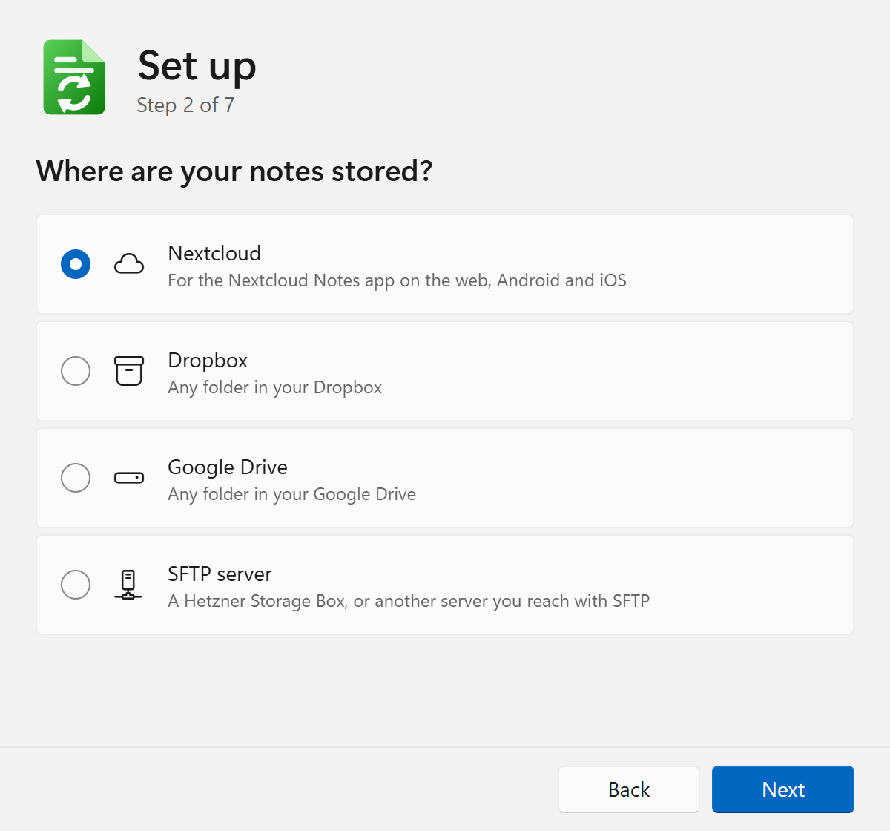
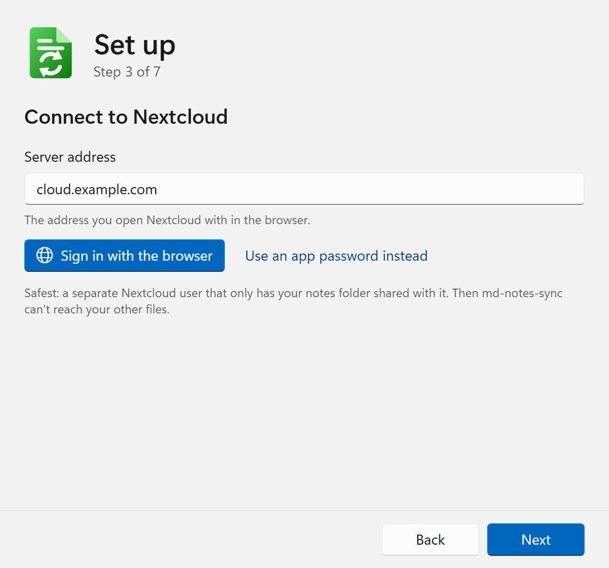
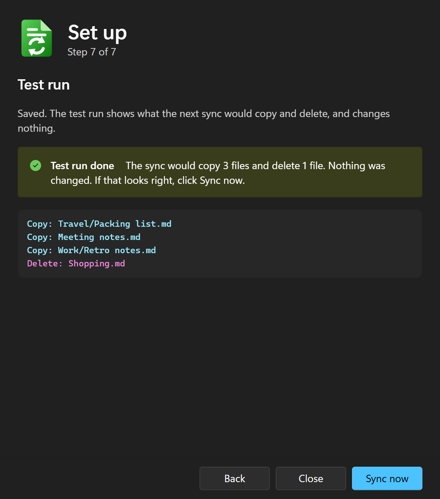

# Setting up and using md-notes-sync

What md-notes-sync does, how to install it, and how it keeps your notes safe is in the [README](README.md).

## Set up

The first start opens the setup and walks you through seven short steps:

 

1. **rclone:** the app downloads rclone from rclone.org into its folder and checks the download against its checksum. If rclone is already installed, it uses that one.
2. **Where are your notes stored?** Nextcloud, Dropbox, Google Drive or an SFTP server.
3. **Connect:**
   - **Nextcloud:** enter the server address (the one you open in the browser, for example `cloud.example.com`) and click **Sign in with the browser**. Nextcloud asks you to allow access and creates an app password for md-notes-sync. You can remove it any time under Settings > Security in Nextcloud. Instead, you can also enter an app password you made yourself.
   - **Dropbox, Google Drive:** click **Sign in with the browser**, sign in and allow access, then come back to the app.
   - **SFTP server:** enter the server address, the port, the user name and the password. For a Hetzner Storage Box (`u12345.your-storagebox.de`) the port is 23; safest is a sub-account that only sees the notes folder. The app saves the server's key and shows its fingerprint, which you can compare with the one your provider publishes.
   - If you already use rclone with this account, the app offers to use that connection.
4. **Notes folder in the cloud:** for Nextcloud, the app asks the Notes app which folder it uses (its name depends on your account's language: `Notes`, `Notizen`, `Notas`, …). Otherwise pick a folder from the list or type one. The app can create it.
5. **Notes folder on this PC:** for example `C:\Users\you\Notes`. If it already has files, the first sync merges them with the cloud: nothing is deleted, and where a file differs on both sides, the newer one wins.
6. **Save.** You can also turn on **Start with Windows** here.
7. **Test run:** the setup shows what the first sync would copy and delete, and changes nothing. If that looks right, click **Sync now**. **Close** leaves it for later. Later test runs are in the tray menu.

To change the cloud or the folders later: **Change** next to "Folders" in the window, or **Set up…** in the tray menu.

## Daily use

- **Left-click the tray icon:** syncs now and shows the window.
- **Right-click the tray icon:** Sync now, Test run, Back up now, Open notes folder, Open sync log, Set up…, Start with Windows, About, Show window, Quit.
- **The icon** is green when all is well, blue while it syncs and red after an error. Hover over it to see when the last sync was.
- **Closing the window** keeps the app in the tray. Quit is in the tray menu.
- **Start with Windows** (tray menu): the app then waits in the tray after you sign in to Windows. It still only syncs when you click it.
- **Updates:** **About** in the tray menu has **Check for updates**: it asks GitHub for a newer version. **Install and restart** downloads it, checks it against the checksum GitHub lists for it, replaces the exe and restarts. Your settings stay. The app never checks by itself.

## Nextcloud Notes, VS Code and Obsidian

With Nextcloud Notes, every note is a plain Markdown file in a folder of your Nextcloud. md-notes-sync keeps that folder in sync with a folder on your PC: notes written on the PC show up in the Notes app on Android, iOS and the web, and notes written on the phone show up on the PC.

### What is synced

| | Synced? | |
|---|---|---|
| Note text | ✅ | One `.md` (or `.txt`) file per note |
| Title | ✅ | The file name is the title. Renaming the file renames the note |
| Categories | ✅ | Categories are folders |
| Modified date | ✅ | Kept exactly, so the order in the Notes app stays right |
| Images in Nextcloud notes | ✅ | In hidden `.attachments.<number>` folders next to the note |
| Deleted notes | ✅ | Deleted on the other side too. Nextcloud keeps them in its trash bin |
| Favourites (star) | ❌ | Nextcloud keeps them in its database, not in the file. Set them in the Notes app |
| Editors' own files | ❌ | Hidden folders like `.obsidian/` and `.vscode/`, databases (`*.sqlite`) and system files stay on the PC |

### Editing the notes

Open the notes folder on the PC in any editor. Several editors can use it at the same time.

One rule matters: **an editor must not change files you didn't edit.** A changed file gets a new modified date and moves to the top of the list on your phone. So turn off anything that rewrites files on its own: trimming trailing spaces, adding a final newline, formatting on save, or Obsidian plugins that edit notes by themselves.

- **VS Code:** with the [Notes extension](https://marketplace.visualstudio.com/items?itemName=dionmunk.vscode-notes), set its notes location (`notes.notesLocation`) to the notes folder. For Markdown files, turn off `files.trimTrailingWhitespace`, `files.insertFinalNewline` and `editor.formatOnSave`. `"markdown.preview.breaks": true` shows line breaks like the Notes app does.
- **Obsidian:** open the folder as a vault. Under Settings > Files and links, turn **Use [[Wikilinks]]** off so links and images use standard Markdown, which the Notes app shows too. Images added in the Notes app are in hidden folders, which Obsidian doesn't show.

## Dropbox, Google Drive, SFTP and other uses

The notes don't have to be in Nextcloud. Any folder of Markdown notes on Dropbox, Google Drive or an SFTP server works the same way: an Obsidian vault, the notes of another app, or just a copy of your notes in the cloud as a backup.

- **Sign-in:** rclone keeps an access token, not your password. You can withdraw the access any time: Dropbox > Settings > Connected apps; Google Account > Security > Third-party connections.
- **SFTP** keeps the notes' dates, like Nextcloud. The server's key is saved at the setup (`known_hosts` in the app folder): if the server ever shows another key, the sync stops and says so. Plain WebDAV servers aren't offered because they lose the dates, and then rclone can miss edits.
- **Google Drive is slower,** especially the first sync. Google limits how fast apps may list and upload files, so rclone sometimes waits up to a minute and the window looks stuck. That's normal. Later syncs only copy what changed. Google Docs and Sheets in the folder are skipped: they aren't real files.

## Files in the app folder

| File | What |
|---|---|
| `md-notes-sync.exe` | The app |
| `THIRD-PARTY-NOTICES.html` | The licenses of the open-source libraries built into the app |
| `sync.conf` | Your settings: the two folders and the sync options. Written by the setup, can be edited by hand |
| `rclone.conf` | The connection to the cloud, with the app password in rclone's obscured form (not encryption) or the access token. Keep the folder private: see [Security](README.md#security) |
| `filters.txt` | What is never synced |
| `known_hosts` | SFTP only: the server's key, saved at the setup |
| `rclone\` | rclone, if the app downloaded it |
| `bisync-state\` | What rclone remembers about the last sync. Don't edit |
| `sync.log`, `backups\` | The log and the weekly backups |
| `webview\` | The window's browser data |

## Troubleshooting

| Problem | What to do |
|---|---|
| "Critical bisync error (exit 7)" | Click **Resync** in the window. It merges both sides and deletes nothing |
| "check access" / `RCLONE_TEST` not found | One side lost its marker file: wrong folder, moved folder, or it was deleted. Open the setup again and save: it puts the marker back |
| 401 Unauthorized | The app password or the access was withdrawn. Open the setup and sign in again |
| No browser opens for the sign-in | Copy the link the setup shows into your browser |
| The Notes folder isn't found | Open the Notes app once in the browser (it creates its folder), or let the setup create it |
| "max delete" | More than 25 % of the files would be deleted. Check that this is wanted (for example in Nextcloud's trash bin) |
| Notes jump to "today" on the phone without being edited | A program rewrote the files: see "Editing the notes" |
| An interrupted sync left a lock | The window says when it runs out and offers **Remove lock and sync** |
| "The SFTP server's key isn't the one saved at the setup" | Either the server was replaced, or someone else answers in its place. Ask your provider. If the change is expected, open the setup, **Sign in again** and compare the new fingerprint |

## Uninstall

Quit the app (tray menu), turn off Start with Windows first if it's on, then delete the folder. Your notes stay where they are, on the PC and in the cloud. Remove the app password in Nextcloud (or the access in Dropbox or Google, or the sub-account on your SFTP server) if you no longer need it.
